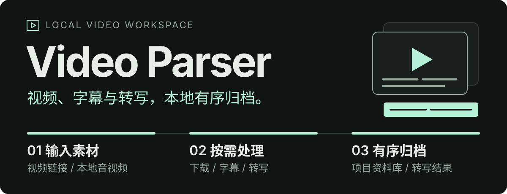
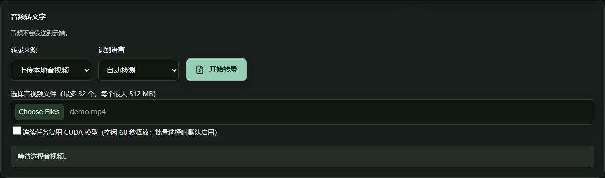
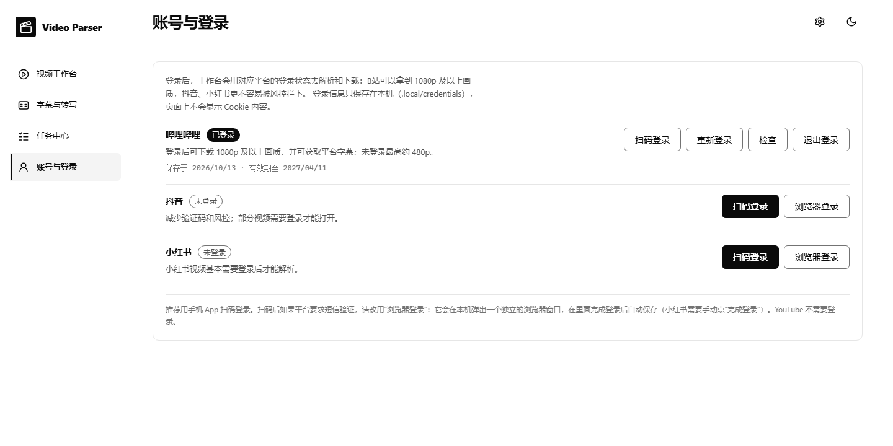

<p align="center">
  
</p>

<p align="center">
  <strong>为个人视频资料管理打造的本地工作台与命令行工具。</strong><br>
  获取视频、整理分集字幕、转写音视频，让素材和处理结果都有处可寻。
</p>

<p align="center">
  <a href="./pyproject.toml"></a>
  <a href="./frontend/package.json"></a>
  <a href="./frontend/package.json"></a>
  <a href="./pyproject.toml"></a>
  <a href="./scripts/setup-local-tools.ps1"></a>
</p>

## 应用截图

### 视频工作台

<p align="center">
  
</p>

2026-10-14 的真实运行界面：解析 Blender Foundation 的《Big Buck Bunny》（CC BY 3.0）后，尚未下载归档时的样子。封面在前，右侧是平台给出的时长、可选画质、项目文件夹和“生成字幕”入口。

### 字幕与转写

<p align="center">
  
</p>

来源可以是上传的音视频，也可以直接从资料库里选一个已归档视频。语言自动识别，不需要手动选。截图为未选择文件时的初始状态。

### 账号与登录

<p align="center">
  
</p>

集中查看各平台的登录状态。登录信息只保存在本机，页面不会显示 Cookie 内容。

## 从一个链接，到一份可继续使用的资料

**链接或本地文件 → 下载 / 字幕 / 转写 → 校验与保存。**

例如，课程字幕和本地转写都归入对应视频项目的 `subtitles/`，文件名标明来源和语言；上传的录音默认保存在 `outputs/transcriptions/`。以下是输出结构示意：

```text
library/
└─ …/视频项目/
   ├─ videos/
   └─ subtitles/
      ├─ <标题>.平台字幕.srt        B站等平台自带字幕（JSON · SRT · MD）
      └─ <标题>.本地转写.zh.srt     本地 Whisper 转写（TXT · SRT · JSON）

outputs/transcriptions/
└─ …/转写任务/
   └─ TXT · SRT · JSON
```

也可以把结果保存到另一个项目，或用 Windows 文件夹选择框指定任意文件夹；写入指定文件夹时从不覆盖同名文件，会自动编号为 `(2)`、`(3)`。

React 工作台用于交互操作，Python CLI 便于脚本调用，两者共用后端服务逻辑。无需数据库，CLI 无需启动 Web 服务。

> **已有验收记录** · 2026-10-13 的本机验收通过 194 项离线测试，并完成真实 CUDA 批处理、任务取消、进程重启和浏览器专项验证。可复验用例见 [离线测试](tests/offline) 和 [运行时测试](tests/runtime)；这是一次已记录的验收，不是实时 CI 状态，本机详细验收输出不随源码发布。

## 三条常用工作流

### 01 · 获取并整理视频

粘贴链接或分享文本，解析标题和可用资源，再选择下载。B站支持本次实际可用的画质及音视频合并；不同画质分别保存。下载后可继续预览、抽帧或分析。

支持的平台：**哔哩哔哩、抖音、小红书、YouTube**。小红书需要先在“账号与登录”页登录，登录后可选 720p（H.264）到 4K（H.265）画质（2026-10-14 实测，详见 [平台实测](docs/mcp-platform-probe-20261014.md)）。好看视频、皮皮搞笑、快手、梨视频、微视的解析器已于 2026-10-14 删除。

- B站画质按视频短边标注：竖屏 1080×1920 显示为 1080p。未登录 B站最高约 480p，登录后可下载 1080p 及以上。
- 下载单个链接失败时会自动重试一次，再换备用链接。

- 下载时显示**当前轨道**的已收字节、可用总大小、实测速率和预计剩余时间；B站音视频分轨分别计量，不把单轨 100% 当成任务完成。
- 总大小缺失或仅为估计值时显示不确定进度；估计总大小明确标为“约”。样本过期、合并及校验阶段不沿用下载速度和剩余时间。
- YouTube 使用 yt-dlp，只处理单个视频（watch、短链接、Shorts、embed、live 链接），不批量处理播放列表或频道；默认选择最高 1080p 的 MP4 组合，优先 AVC 视频与 M4A 音频，并使用本机 FFmpeg 合并。实际可用格式及画质以平台返回为准。
- 本轮公开授权 YouTube 样本使用 Blender Foundation 的《Sintel》（CC BY 3.0），实测范围与限制见 [下载反馈与 YouTube 验收](docs/mcp-download-feedback-youtube.md)。

解析不会自动下载完整视频。平台支持受页面变化、登录状态、权限和风控影响，不保证每个链接可用，也不绕过访问权限。浏览器不能播放某种编码时，可打开项目文件夹交给本地播放器。

### 02 · 字幕与转写（平台字幕优先，没有再本地转写）

在视频工作台点“生成字幕”，或在“字幕与转写”页选一个已归档视频：B站视频有平台字幕时直接下载（可选当前、全部或指定分集），没有时再用本地 Whisper 转写。

- 平台字幕输出 **JSON / SRT / MD**，支持重试未完成分集；需要 B站登录。
- 结果默认保存到视频所在项目的 `subtitles/`，也可选另一个项目或自定义文件夹。
- 不会自动复制到浏览器下载目录；通过“打开项目文件夹”查看。

### 03 · 本地转写音视频

上传本地文件（或选已归档视频）→ 自动识别语言 → 分文件排队 → 本地 CUDA 转写 → 查看文本或下载 TXT / SRT。

- 语言自动识别；识别结果不对时可以换一种语言重新转写。
- 一次最多选择 **32 个文件**，单文件失败不阻断其他任务。
- 可选模型复用，默认空闲 **60 秒** 后释放。
- 固定使用本地 **large-v3-turbo / CUDA / int8_float16**，不自动回退 CPU、云端或其他模型。
- 每个文件独立保存结果，JSON 也保留在本机输出目录。

### 04 · AI 分析（视频工作台 → AI 分析）

选模板 → 选依据（字幕 + 画面 / 只用字幕 / 只用画面）→ 预览并勾选画面 → 开始分析 → 查看、追问、导出。

- 模板：内容摘要、章节时间轴、学习笔记、短视频拆解、分镜表、提取口播文案，也可以“自定义”或在任一模板上补充要求。
- 依据字幕时读取项目 `subtitles/` 里的平台字幕或本地转写；没有字幕时会提示“生成字幕”，一键跳到“字幕与转写”。
- 画面默认按镜头切换选取，数量按时长自动决定（最多 16 张），也可改为均匀选取或指定张数；发送前可以点掉不想发的画面。
- 结果按 Markdown 排版显示，时间戳可点击跳到视频对应位置；支持复制、导出 Markdown / Word，并显示本次用到的画面。
- 每个视频保留分析记录（模板、时间、追问），可在记录上继续追问；记录保存在项目的 `analysis/`，画面保存在 `frames/`。
- 未归档的视频可以直接点“归档并分析”。
- 模型在“设置 → AI 模型”里填写，保存立即生效，无需改 `.env` 或重启：可选魔搭社区、阿里云百炼、本机 Ollama 或任意 OpenAI 兼容接口；填写单价后显示费用估算。每个服务第一次分析时确认一次数据发送，本机模型不需要确认。

### 账号与登录

左侧导航“账号与登录”集中管理 **哔哩哔哩、抖音、小红书** 的登录状态（YouTube 不需要登录）：

- 三个平台都可以点“扫码登录”，用手机 App 扫页面上的二维码（小红书也可以用微信扫）。抖音、小红书的二维码由后台一个不显示窗口的浏览器打开官方登录页取得，扫码确认后自动保存。
- 扫码后如果平台要求短信验证等进一步验证，请改用“浏览器登录”：会在本机弹出一个独立浏览器窗口，登录成功后自动保存并关闭（小红书需手动点“完成登录”）。
- 登录后，解析和下载会自动使用对应平台的登录状态：B站解锁高画质，抖音、小红书减少验证和风控。YouTube 普通视频不登录也能拿到全部画质；年龄限制、会员专属视频不支持。
- 登录信息保存在本机 `.local/credentials/`，页面和接口都不会返回 Cookie 内容；可随时“检查”或“退出登录”（删除本机文件）。

## 快速开始

以下命令在仓库根目录的 **Windows PowerShell** 中执行。

### 准备环境

- Python **3.11+**：统一安装脚本可准备项目内 Python 环境。
- Node.js **22.12+** 与 npm：用于前端安装和构建。
- FFmpeg / FFprobe：需要能从 `PATH` 调用。
- `uv`：用于统一安装流程。
- 本地转写需要兼容的 **NVIDIA GPU 与 CUDA 运行环境**；基础解析、下载、抽帧不依赖 GPU。

### 安装 → 检查 → 启动

```powershell
# 准备运行环境、浏览器、固定模型和前端
.\scripts\setup-local-tools.ps1 -DownloadModel

# 检查模型摘要、CUDA、浏览器、写权限与磁盘
.\.venv\Scripts\python.exe cli.py doctor --deep --json

# 打开本地工作台
.\start-web.ps1 -OpenBrowser
```

访问 **http://127.0.0.1:15001**，粘贴链接开始；也可双击 `start-web.cmd`。保持终端开启，按 `Ctrl+C` 停止。需要换端口时，使用 `-Port 15002`。

首次安装需要网络，模型和 NVIDIA 依赖较大。只使用 CLI 可给安装脚本加 `-SkipFrontend`。主环境、Whisper 和前端分别使用锁文件；安装器遇到未经审查的主环境依赖降级会停止。换机器或移动目录后应重新创建虚拟环境，不要直接复制旧环境。

## 命令行也能独立使用

```powershell
# 解析链接 / 下载本次可用的最高画质
.\.venv\Scripts\python.exe cli.py parse "视频链接或分享文本" --json
.\.venv\Scripts\python.exe cli.py download "B站视频链接" --quality best

# 单文件转写 / 批次内复用模型
.\.venv\Scripts\python.exe cli.py transcribe "素材.mp4" --language zh --timestamps
.\.venv\Scripts\python.exe cli.py transcribe-batch "素材一.wav" "素材二.mp4" --language zh --json
```

<details>
<summary><strong>更多命令：封面、抽帧、分析与本地列表</strong></summary>

```powershell
.\.venv\Scripts\python.exe cli.py cover "视频链接"
.\.venv\Scripts\python.exe cli.py frames "素材.mp4" --count 8
.\.venv\Scripts\python.exe cli.py analyze "素材.mp4" --frames 6
.\.venv\Scripts\python.exe cli.py list --json
.\.venv\Scripts\python.exe cli.py capabilities --json
```

分析命令需要先配置模型服务。运行 `cli.py <命令> --help` 查看完整参数。

</details>

批量转写部分失败时退出码为 `1`，成功结果仍保留。B站平台字幕下载通过工作台提供；`transcribe` 是语音识别，不是下载平台字幕。

## 长任务，有状态也有边界

| 操作 | 实际行为 |
| --- | --- |
| 刷新页面 | 重新连接已有任务，不重复提交 |
| 取消任务 | 停止所属工作进程或在安全检查点结束；清空输入不等于取消 |
| 重启服务 | 未完成任务标记为中断，需手动重试，不自动续跑推理或付费分析 |
| 清理缓存 | 先预览再确认，只清理符合条件的程序自有临时目录 |
| 复用资源 | 保留完整 SHA-256 校验与路径保护，不用大小或 mtime 替代内容校验 |

资料库、模型、Cookies、原始素材和转写成果不属于缓存清理范围。详细规则见 [任务、缓存与批量转写](docs/task-runtime.md)。

## 配置与隐私

按需将 `.env.example` 复制为 `.env`，修改后重启服务。基础解析、下载和抽帧不需要 AI 密钥。AI 模型推荐直接在工作台“设置 → AI 模型”里填写（保存在本机 `.local/ai/settings.json`，优先于下表的 `QWEN_*`）；命令行 `cli.py analyze` 仍只读取 `.env`。

| 配置 | 用途 |
| --- | --- |
| `QWEN_API_KEY` | 后端模型服务密钥 |
| `QWEN_API_BASE_URL` | OpenAI 兼容接口地址 |
| `QWEN_MODEL_ID` | 视觉模型标识 |
| `MAX_FRAMES` | AI 分析默认抽样帧数 |
| `VIDEO_LIBRARY_ROOT` | 资料库路径，默认 `library/` |

**本地转写不上传音视频；AI 分析会把所选画面和/或字幕文本发送给配置的模型服务（本机模型除外）。** 分析前请确认素材允许上传。AI 分析不读取音轨，需要语音内容时请先生成字幕；取消本地等待无法保证撤销服务端已经产生的计算或费用。

工作台默认仅监听本机回环地址，**不要直接暴露到公网**。不要分享或提交 `.env`、Cookies、私人配置、模型、运行环境及处理结果；密钥不能写进前端代码或 `VITE_*` 变量。Git 忽略规则不等于加密，也不会移除已经提交的敏感内容。

## 项目结构与开发

<details>
<summary><strong>查看目录职责</strong></summary>

```text
src/video_parser/
├─ web/              FastAPI 与工作台接口
├─ services/         任务、资源库、下载、字幕、转写与分析
├─ integrations/     B站字幕与 Whisper 模块
├─ platforms/        平台解析器
├─ core/             路径、配置与日志
└─ cli.py            CLI 实现
frontend/            React + TypeScript 工作台
assets/readme/       README 静态 SVG 视觉资源
scripts/             安装、校验与性能检查
requirements/        Python 环境锁文件
tests/               离线、浏览器、运行时与真实平台测试
docs/                使用、架构与开发文档
library/             正式资料库
outputs/             转写结果与其他本地产物
cache/               临时文件与可复用缓存
models/              本地模型
runtimes/            独立运行环境与浏览器
.local/              本地凭据与任务记录
```

数据与运行目录按安装、使用情况生成。根目录 `cli.py` 是命令行入口，`start-web.ps1` 是工作台启动器。当前支持源码仓库运行，不承诺单独安装 wheel 即可获得完整前端和本机配置。

</details>

```powershell
# 离线回归 / 类型检查与生产构建
.\.venv\Scripts\python.exe -m unittest discover -s tests/offline -p "test_*.py"
npm.cmd --prefix frontend run build

# 开发前端（另行启动 15001 后端）
npm.cmd --prefix frontend run dev
```

开发前端默认在 `http://127.0.0.1:5173`，代理 API 到 `15001`。后端提供 `/health` 与 `/docs`。GPU 和真实平台测试需显式运行，不属于默认离线回归。

[项目架构](docs/architecture.md) · [开发指引](docs/development.md) · [任务使用说明](docs/task-runtime.md)

## 许可与使用范围

适用的许可与第三方代码说明见 [LICENSE](LICENSE) 和 [许可说明](docs/integrated-tools-provenance.md)。不同来源的代码可能适用不同许可，发布或分发前请确认授权范围。请仅处理拥有或获得授权的素材，并遵守平台条款。
