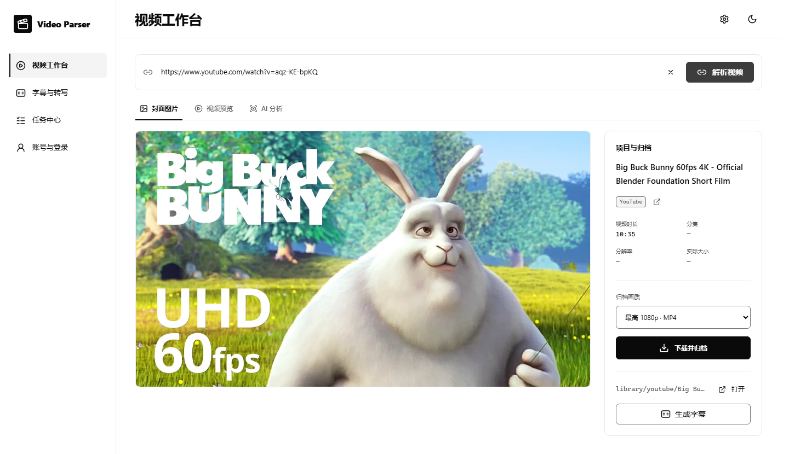
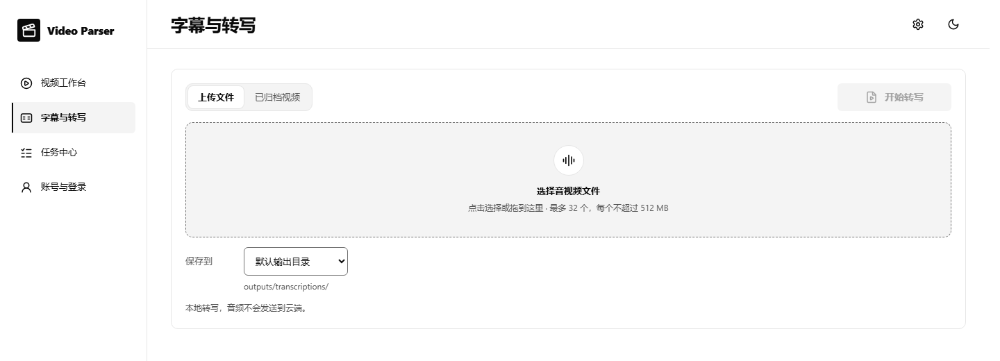
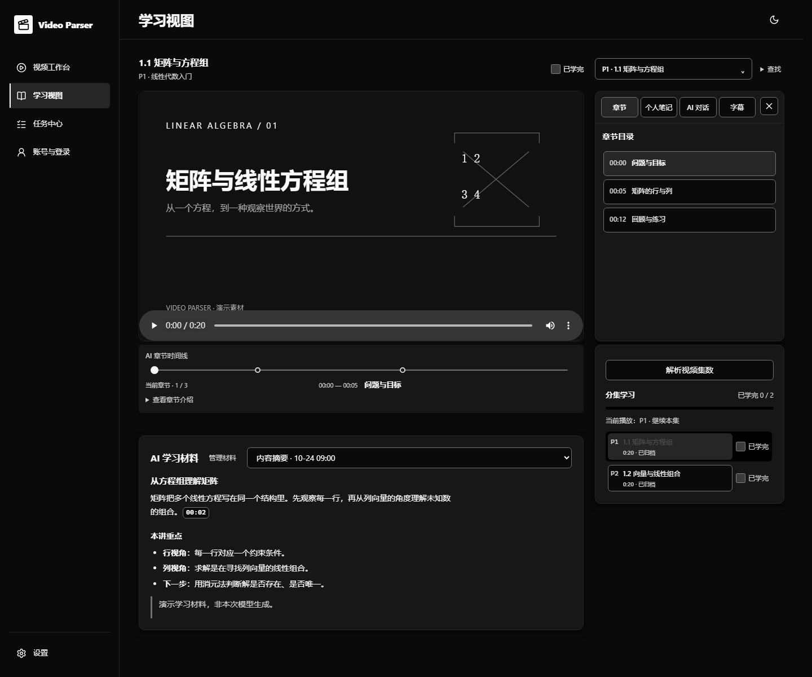
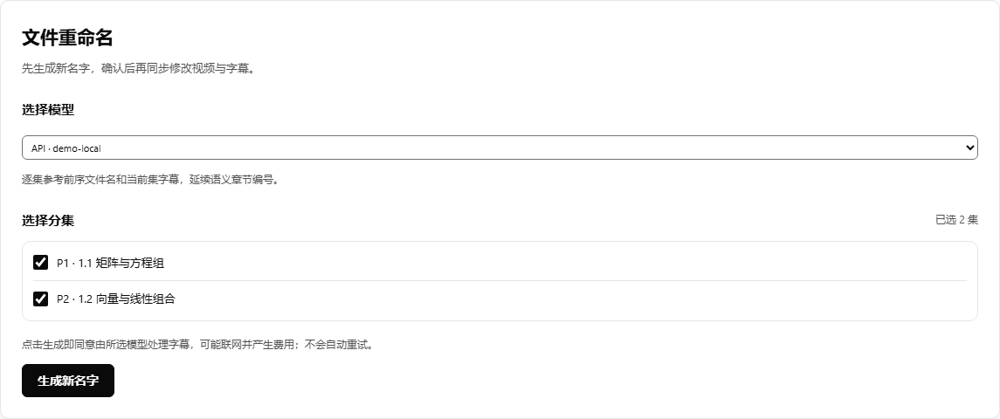
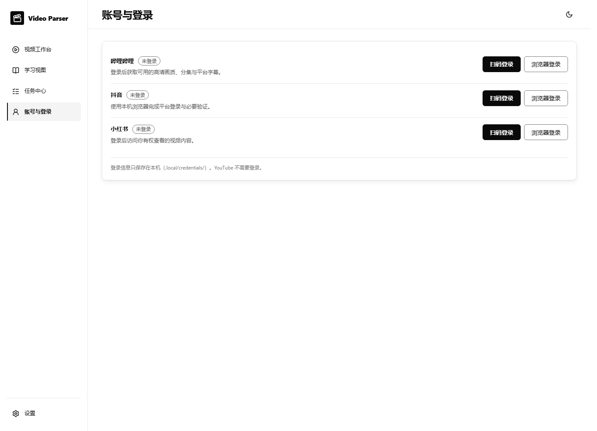

<p align="center">
  
</p>

<p align="center">
  <strong>把视频、字幕和学习材料放回同一个项目。</strong><br>
  本地优先的视频工作台：下载归档、语音转写、字幕翻译、AI 分析、文件整理与分集学习。
</p>

<p align="center">
  
  
  
  
  
</p>

<p align="center">
  <a href="#快速开始">快速开始</a> ·
  <a href="#当前界面">当前界面</a> ·
  <a href="#功能与使用边界">功能与使用边界</a> ·
  <a href="#资料保存在哪里">资料保存在哪里</a> ·
  <a href="#开发与验证">开发与验证</a>
</p>

## 这是什么

Video Parser 面向个人视频资料整理与学习。粘贴视频链接，或选择本地音视频，按需获取字幕、转写、翻译和分析；结果保存在本机，之后可以按项目与分集继续查看、做笔记和整理文件名。

- **视频工作台**有四个独立视图：视频、字幕与转写、AI 分析、文件重命名。
- **学习视图**围绕当前分集组织播放器、章节、字幕、学习材料、笔记与 AI 对话。
- **任务中心**统一查看下载、字幕、转写、翻译、分析和命名任务，按类型、状态和项目筛选。
- **黑白双主题**、中文／英文界面，适配桌面与窄屏。

> **本地优先不等于所有操作都离线。** 视频解析和下载需要访问平台；本地 Whisper 转写不上传音视频；翻译、分析、命名建议与对话会向你选定的模型服务发送对应内容。没有点击相应执行按钮，不会因切换页面或模型而自动开始生成。

## 快速开始

### 从源码运行 · Windows PowerShell

在仓库根目录执行。先准备 **[uv](https://docs.astral.sh/uv/)、Node.js 22.12+ 与 npm、可用的 FFmpeg／FFprobe**。Python 包声明支持 3.11+；统一安装脚本会准备项目内的托管 Python，具体版本以脚本和锁文件为准。

```powershell
# 安装依赖、项目内运行环境、Chromium，并构建前端
.\scripts\setup-local-tools.ps1

# 启动本地工作台并打开浏览器
.\scripts\start-web.ps1 -OpenBrowser
```

默认访问 **http://127.0.0.1:15001**。之后也可双击 `start-web.cmd`；需要另一个端口时使用 `-Port 15002`。首次安装需要网络，依赖和浏览器下载可能较大。安装器遇到未经审查的主环境依赖降级时会停止，不会静默覆盖。

<details>
<summary><strong>需要本地语音转写？</strong></summary>

本地转写需要兼容的 **NVIDIA GPU、驱动及 CUDA 运行环境**。基础视频解析、下载和字幕查看不要求 NVIDIA GPU。

```powershell
# 显式下载并校验固定的 Whisper 模型
.\scripts\setup-local-tools.ps1 -DownloadModel

# 深度检查本机组件、模型、CUDA、权限与磁盘
.\.venv\Scripts\python.exe cli.py doctor --deep --json
```

安装脚本默认也会准备独立的 Whisper 依赖环境，但不带 `-DownloadModel` 时跳过模型下载。转写固定使用 `large-v3-turbo / CUDA / int8_float16`，不会自动回退 CPU、云端或其他模型。

只使用 CLI 可加 `-SkipFrontend`。移动仓库或换机器后应重新创建虚拟环境，不要直接复制旧 `.venv`。

</details>

### Windows 发行包

如需免源码安装，请查看 [GitHub Releases](https://github.com/Celyn-number3/video-parser/releases)：**可下载的版本与包含组件以对应 Release 说明为准**，不是源码的新功能都会立即进入发行包。

仓库提供 Windows 10/11 x64 安装版与便携版的构建流程。桌面包使用 WebView2，缺少时可回退默认浏览器；不打包本地大模型或 Whisper/CUDA 转写环境。下载后核对 `SHA256SUMS.txt`；未签名构建可能触发 SmartScreen 提示，不要跳过来源与哈希核验。

## 当前界面

以下截图由 **2026-10-24 的当前前端构建**生成，使用隔离的演示数据，不展示个人归档、真实账号或密钥。封面、字幕和学习材料均为演示内容，不代表本次真实下载或模型调用。

### 视频工作台 · 同一项目，四个视图



先选择项目和分集，再处理当前视频。解析不会自动下载完整视频；画质以平台实际返回为准。切换字幕页的分集会同步工作台选择，避免看到另一集的正文。

### 字幕与转写 · 先选来源，再看版本



“**查看来源／字幕版本**”与“**获取方式**”分开：选中了本地转写的操作方式，不代表当前显示的就是本地转写结果。平台字幕、本地转写、AI 译文按归档记录区分，不靠文字语言猜测；旧记录缺少来源或语言时明确标注。完成任务会加入可查看的版本，不抢占正在阅读的内容。

### 学习视图 · 内容与当前分集一起走



在播放器下阅读学习材料，在右侧查看字幕、章节、笔记或 AI 对话。摘要与章节可以并存；切换分集时同步内容，已学完状态在分集选择区域管理。生成／管理学习材料保留独立入口。

### 文件重命名 · 建议不是执行



命名是工作台第四个视图，不再藏在学习页面。选模型与分集 → 生成或编辑建议 → 查看真实文件改名预览 → **单独确认执行**。支持视频与字幕一起改名，按顺序参考系列上下文；单个视频使用标题，不强加 `1.1` 编号。项目主文件夹名称与分集文件名分别管理。

<details>
<summary><strong>账号与登录 · 查看当前浅色界面</strong></summary>



统一管理哔哩哔哩、抖音、小红书的登录状态。根据平台提供扫码或浏览器登录；遇到额外验证，按平台提示操作。登录信息只保存在本机，不在页面返回 Cookie 内容。YouTube 普通公开视频不要求登录，受限内容不保证可用。

</details>

## 功能与使用边界

| 功能 | 可以做什么 | 需要注意 |
| --- | --- | --- |
| 视频获取 | 哔哩哔哩、抖音、小红书、YouTube 的链接解析与下载；B站分集和可用画质选择 | 受登录、权限、平台格式及风控影响，不保证所有链接可用，不绕过访问限制 |
| 平台字幕 | B站当前、全部或指定分集字幕；补齐缺失分集，重试未完成部分 | 需要相应登录状态；并非每个视频都有平台字幕 |
| 本地转写 | 上传音视频或选择归档视频，自动识别语言；TXT / SRT / JSON 输出 | NVIDIA / CUDA；最多选择32个文件，单文件失败不阻断整个批次 |
| AI 字幕翻译 | 中英互译、时间戳保留、译文独立保存并可重载查看 | 仅发送字幕文本，不发送音视频；长字幕分批，可能多次计费，失败不自动重试 |
| AI 分析 | 摘要、章节时间轴、学习笔记、短视频拆解、分镜、口播文案及自定义要求 | 依据可选字幕＋画面、只用字幕或只用画面；缺少所需字幕时提示补充，不静默降级 |
| 分集学习 | 章节跳转、字幕跟随、学习材料、时间点笔记和上下文对话 | 围绕当前项目及分集组织；空材料状态仍可进入生成／管理 |
| 文件整理 | 项目名、系列分集名建议，视频与字幕同步改名 | 先预览、后确认；不会仅因生成建议就修改磁盘文件 |
| 任务与检索 | 查看长任务、筛选状态、定位分集；任务中心顶部提供字幕语义检索 | Embedding 独立配置；生成向量与检索需要相应服务 |

### 下载与长任务

- B站音视频分轨下载，进度按当前轨道计量；合并与校验是后续阶段，单轨100%不等于整项任务完成。总大小未知时显示不确定进度，不伪造完成比例。
- YouTube 通过 yt-dlp 处理单个视频链接，不批量下载频道或播放列表；默认选择最高1080p的MP4组合，实际格式取决于平台。
- 不能在浏览器播放的编码可交给本地播放器；解析或下载失败不等于文件一定损坏。
- 转写运行时仍可切换分集查看其他内容；切换不会取消后台任务。取消需要明确操作，刷新页面不会重新提交同一任务。
- 服务重启后，未完成任务会标记中断，需要手动重试；不会自动重放推理或付费分析。

### 模型调用与设置

工作台支持配置 API 模型、本机模型服务，以及已安装的 Claude Code、Codex、OpenCode 等引擎；实际可选项以本机检测与设置为准。

- 不同工具可分别选择模型；某个工具的 Agent 开关不等于全局开关。
- 保存模型设置与启动／停止本机模型是不同操作，保存配置不会自动重启模型。
- Embedding 有自己的配置与调用入口，不与聊天模型设置混为一体。
- 翻译和分析可能把文本、所选画面发送到外部服务，开始前请确认材料允许发送。取消本地等待不能保证撤销服务端计算或费用。

### Whisper 内存说明

长音频特征提取采用分块 FFT，中间矩阵不再一次按完整音频时长展开；保留原始帧网格与全局特征归一化。错误提示区分系统内存、CUDA 显存和无法确定来源的分配失败，并在任务输出目录的 `.whisper.log` 留下诊断。

这不是恒定内存转写：解码、VAD、完整波形与特征结果仍会占用内存。内存不足时不会自动关闭其他程序、调整分页文件或换模型；优化也不构成所有长音频都能完成的保证。

## 资料保存在哪里

下面是结构示意，实际项目名、编号和文件名以归档记录为准：

```text
outputs/
├─ bilibili/
│  ├─ 课程标题__BV…/
│  │  ├─ P001-1.1 矩阵与方程组/
│  │  │  ├─ videos/
│  │  │  ├─ subtitles/     平台字幕、本地转写与独立译文
│  │  │  ├─ analysis/      AI 分析与学习材料
│  │  │  └─ frames/        分析使用的画面
│  │  └─ P002-1.2 向量与线性组合/
│  └─ 单个视频标题__BV…/    单视频不额外套一层 P001
│     ├─ videos/
│     └─ subtitles/
└─ transcriptions/          独立上传转写／翻译任务结果
```

新生成的字幕文件会标明来源，例如 `<标题>-B站平台字幕.srt`、`<标题>-英文-本地转写.srt`。AI译文单独保存，原字幕保留。既有历史文件不因界面更新而被自动重命名。

结果默认归入当前项目，也可选择其他项目或自选文件夹。同名文件受保护，不静默覆盖。使用页面的“打开文件夹”查看，不会自动再复制一份到浏览器下载目录。

**`outputs/` 是持久成果，不是缓存。** 模型、登录凭据、原始素材、学习记录和任务日志也不属于随意清理的对象。清理缓存需要先预览、再确认，详情见[任务、缓存与批量转写](docs/task-runtime.md)。

## 命令行

CLI 不要求启动 Web 服务。以下命令在仓库根目录执行：

```powershell
# 解析与下载
.\.venv\Scripts\python.exe cli.py parse "视频链接或分享文本" --json
.\.venv\Scripts\python.exe cli.py download "B站视频链接" --quality best

# 本地语音识别；不是下载平台字幕
.\.venv\Scripts\python.exe cli.py transcribe "素材.mp4" --language zh --timestamps
.\.venv\Scripts\python.exe cli.py transcribe-batch "素材一.wav" "素材二.mp4" --language zh --json

# 本机能力检查
.\.venv\Scripts\python.exe cli.py capabilities --json
```

`--language zh` 是显式指定中文，不是自动识别示例。批量转写部分失败时退出码为1，成功文件仍保留。封面、抽帧、分析和本地列表等命令请用 `cli.py --help` 或 `cli.py <命令> --help` 查看。

CLI 的分析配置仍读取 `.env`；工作台的模型设置与 CLI 配置不能假定完全相同。

## 隐私与安全

- 默认只监听本机回环地址，**不要直接把工作台暴露到公网**。
- 登录信息在 `.local/credentials/`；工作台模型设置及其他私有配置在 `.local/`。不要提交或分享这些目录、`.env`、模型与个人处理结果。
- AI 密钥不能写入前端源码或 `VITE_*` 变量。Git 忽略规则不是加密，也不能清除已经提交的敏感内容。
- 基础解析、下载与抽帧不需要 AI 密钥；只有选定模型的操作才需要相应服务配置。
- 本项目不提供绕过付费、DRM、访问控制或平台权限的功能。请只处理你拥有或已获授权的素材。

## 开发与验证

```text
backend/video_parser/    Python 后端：平台解析、服务、Web API 与 CLI
frontend/src/            React + TypeScript 前端
scripts/                 安装、启动、校验与维护脚本
configs/requirements/    主环境、Whisper 等依赖锁文件
tests/                   离线、浏览器、运行时与真实平台测试
docs/assets/readme/      本页的 SVG 与演示截图
outputs/                 持久业务成果
runtimes/                项目内工具环境、浏览器与 models/
.local/                  私有配置与任务；work/ 下为缓存、日志和验收证据
```

```powershell
# 默认离线回归
.\.venv\Scripts\python.exe -m unittest discover -s tests/offline -p "test_*.py"

# 类型检查与前端构建
npm.cmd --prefix frontend run build

# 开发前端：另行启动15001后端
npm.cmd --prefix frontend run dev
```

开发前端默认在 http://127.0.0.1:5173，API 代理到15001。后端提供 `/health` 与 `/docs`。GPU推理、真实平台访问和需要模型的验收必须显式执行，不能把离线测试通过当成真实转写成功。

[项目架构](docs/architecture.md) · [开发指引](docs/development.md) · [任务与缓存](docs/task-runtime.md) · [术语表](docs/GLOSSARY.md)

## 许可

查看 [LICENSE](LICENSE) 与[集成工具来源和许可](docs/integrated-tools-provenance.md)。不同来源的代码可能适用不同许可，分发前请核对授权范围。下载与使用素材时，还需遵守版权法律及平台条款。
